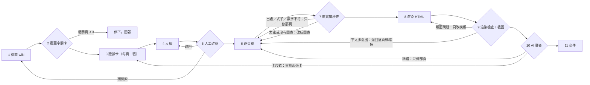

# Workflow: topic-slides

> 依「10 把你的工作拆成 AI 能做的流程」第 41–47 頁的 Graph 做法：使用者說一個主題，只用 CMP-wiki 的內容做一份 HTML 簡報。
> 呼叫方式：`/topic-slides <主題>`（Claude Code 透過 `.claude/skills/topic-slides/SKILL.md` 讀這份檔）。
> 每一關的產出都是檔案，可以打開看、放進 git、單獨重跑。

## Definition of done
- 只用 `wiki/` 的內容；每一頁都標出處（wiki 頁名），引用的頁都存在。
- 頁面上的數字都能在引用的證據卡中找到。
- 8–15 頁。
- 版面密度：title 以外的每一頁至少有一個圖表元件、表格或獨立數學式；文字量（中文字數＋英文詞數）≤ 110。
- 渲染後沒有任何一頁溢出；每個數學式都已渲染、而且每一個可見部件都在它的方框內；量測時字型已載入完成。
- 人看過逐頁截圖（腳本抓不到的版面問題，例如方框內容被拆成好幾行）。
- 獨立的 AI 審查（新對話，只看簡報和引用頁）確認忠實度與覆蓋率。

## State (files)
```
slides/topic-<slug>/
├── sources.md     檢索結果：相關 wiki 頁與理由
├── cards/         證據卡：每頁 wiki 一張，只含那一頁的內容
├── outline.md     大綱：每張投影片的標題、要點、用到的卡片
├── drafts/        逐頁稿：NN-<slug>.md
├── deck.html      渲染出的簡報
└── report.md      檢查報告（每一關的結果與退回紀錄）
```

## Graph


## Nodes: what each may read and change

| # | 節點 | 類型 | 只能看 | 產出 | 不能做 |
|---|---|---|---|---|---|
| 1 | 檢索 wiki | AI | `index.md`、wiki 頁名與 aliases（`lint.py --find`） | `sources.md` | 讀 `raw/`、用一般知識補頁 |
| 2 | 覆蓋率關卡 | 腳本 | `sources.md` | 通過／停下 | — |
| 3 | 證據卡 | 腳本 | 一張卡只看一頁 wiki | `cards/*.md` | 混入其他頁、改寫內容 |
| 4 | 大綱 | AI | `cards/` | `outline.md` | 引用卡片以外的內容 |
| 5 | 人工確認 | 人 | `outline.md` | 同意／退回 | — |
| 6 | 逐頁稿 | AI | `outline.md`＋該頁對應的卡片 | `drafts/NN-*.md` | 引用卡片以外的內容、加數字 |
| 7 | 忠實度＋密度檢查 | 腳本 | `drafts/`、`cards/`、`wiki/` | 報告（出處、式子、數字、每頁文字量與圖表） | 自己動手改 |
| 8 | 渲染 HTML | 腳本 | 已通過的 `drafts/` | `deck.html` | 改任何一個字 |
| 9 | 渲染檢查 | 腳本（headless Chrome）＋人看截圖 | `deck.html` | 報告（溢出、式子超出方框、未渲染、字型未載入）＋逐頁截圖 | 自己動手改 |
| 10 | AI 審查 | AI（新對話） | `deck.html` 的文字＋被引用的 wiki 頁 | 審查意見 | 自己動手改、看其他檔案 |
| 11 | 交件 | — | 全部 | `report.md` 定稿 | — |

## Commands
```bash
T=slides/topic-<slug>
python3 scripts/slides/coverage_check.py $T     # 2
python3 scripts/slides/make_cards.py $T         # 3
python3 scripts/slides/check_drafts.py $T       # 7
python3 scripts/slides/render_deck.py $T        # 8
python3 scripts/slides/render_check.py $T       # 9（需要 google-chrome）
```

## Lessons built into the gates (2026-11-23)
上線後使用者回報三個問題，每一個都寫進關卡，而不是只修這一份簡報：

| 問題 | 原因 | 寫進哪一關 |
|---|---|---|
| 長數學式超出顯示範圍（第 3 頁） | 縮字在字型載入前量測，量到後備字型；渲染檢查也在字型載入前量 | 模板：先讓每頁排版一次、等字型全部載入才縮字；關卡 9：字型不是 `loaded` 就不算通過 |
| 右下角說明文字蓋到頁尾 | 說明文字固定在視窗角落，和投影片重疊 | 模板：課程出處移進每頁頁尾，按鍵提示放右上角、4 秒後淡出 |
| 文字密度偏高 | 規格沒有限制文字量 | 關卡 7：每頁要有圖表／表格／獨立式子，文字量 ≤ 110；不過就退回逐頁稿改成圖表 |

修正過程中又發現、也一併寫進關卡 9 的：
- KaTeX 從 CDN 晚到時式子不渲染 → 模板最多等 10 秒；檢查整頁（含重點句）有沒有未渲染的 `$`。
- 圖表標籤的 CSS 誤套到 KaTeX 內部，式子部件跑位 → 檢查量測式子裡每一個可見部件是否在方框內。用「把錯誤放回去」的迴歸測試確認抓得到。

## Loops inside nodes
- 逐頁稿：寫一頁 → 跑 `check_drafts.py` → 修，最多 2 輪；還不過就記進 `report.md` 交給人。
- 渲染：產生 HTML → 渲染檢查（含截圖）→ 修版面（只改 CSS／模板，不改字）→ 再檢查。
- 每修好一種檢查漏掉的錯，就把錯誤放回副本、確認新檢查抓得到（迴歸測試），再恢復。

## Stop conditions
- 相關 wiki 頁少於 3 頁：一開始就停下。
- 任一檢查關卡退回 3 輪仍不過：停下，把問題寫進 `report.md` 交給人。

## Draft format (drafts/NN-slug.md)
```markdown
---
cards: [electron density, external potential]
layout: bullets        # title | bullets | equation | flow | compare | split | closing
---
# 投影片標題（英文）
> 一句話重點（繁中＋英文術語）

- 要點一 〔electron density〕
- 要點二 〔external potential〕

$$ 數學式（只能來自卡片） $$

flow: A -> B -> *C〔頁名〕               # 橫向流程；* 標重點；<-> 雙向
stack: A -> *B -> C〔頁名〕              # 直向流程
cycle: A -> B -> C || 回到起點的條件〔頁名〕 # 迴圈（下方有返回箭頭）
grid: 標題 :: 說明 | 標題 :: 說明〔頁名〕  # 卡片並排
ladder: 高能階 || 差距名 || 低能階〔頁名〕  # 能階梯
curve: x 軸 || y 軸 || 最小值標籤〔頁名〕   # 自繪示意曲線（有最小值）
chain: !kind :: 步驟 | kind :: 步驟〔頁名〕  # 編號鏈；! 標示引入近似的步驟
```
- 圖表元件整行算一個要點，同樣要有出處；元件裡的字也算進文字量。
- 每個要點句末用 `〔wiki 頁名〕` 標出處；頁名必須在 `cards:` 裡。
- 所有標題用英文（AGENTS.md §3-11）。
