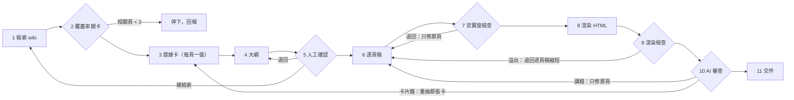

# Workflow: topic-slides

> 依「10 把你的工作拆成 AI 能做的流程」第 41–47 頁的 Graph 做法：使用者說一個主題，只用 CMP-wiki 的內容做一份 HTML 簡報。
> 呼叫方式：`/topic-slides <主題>`（Claude Code 透過 `.claude/skills/topic-slides/SKILL.md` 讀這份檔）。
> 每一關的產出都是檔案，可以打開看、放進 git、單獨重跑。

## Definition of done
- 只用 `wiki/` 的內容；每一頁都標出處（wiki 頁名），引用的頁都存在。
- 頁面上的數字都能在引用的證據卡中找到。
- 8–15 頁。
- 渲染後沒有任何一頁溢出、沒有數學式錯誤。
- 獨立的 AI 審查（新對話，只看簡報和引用頁）確認忠實度與覆蓋率。

## State (files)
```
slides/topic-<slug>/
├── sources.md     檢索結果：相關 wiki 頁與理由
├── cards/         證據卡：每頁 wiki 一張，只含那一頁的內容
├── outline.md     大綱：每張投影片的標題、要點、用到的卡片
├── drafts/        逐頁稿：NN-<slug>.md
├── deck.html      渲染出的簡報
└── report.md      檢查報告（每一關的結果與退回紀錄）
```

## Graph


## Nodes: what each may read and change

| # | 節點 | 類型 | 只能看 | 產出 | 不能做 |
|---|---|---|---|---|---|
| 1 | 檢索 wiki | AI | `index.md`、wiki 頁名與 aliases（`lint.py --find`） | `sources.md` | 讀 `raw/`、用一般知識補頁 |
| 2 | 覆蓋率關卡 | 腳本 | `sources.md` | 通過／停下 | — |
| 3 | 證據卡 | 腳本 | 一張卡只看一頁 wiki | `cards/*.md` | 混入其他頁、改寫內容 |
| 4 | 大綱 | AI | `cards/` | `outline.md` | 引用卡片以外的內容 |
| 5 | 人工確認 | 人 | `outline.md` | 同意／退回 | — |
| 6 | 逐頁稿 | AI | `outline.md`＋該頁對應的卡片 | `drafts/NN-*.md` | 引用卡片以外的內容、加數字 |
| 7 | 忠實度檢查 | 腳本 | `drafts/`、`cards/`、`wiki/` | 報告 | 自己動手改 |
| 8 | 渲染 HTML | 腳本 | 已通過的 `drafts/` | `deck.html` | 改任何一個字 |
| 9 | 渲染檢查 | 腳本（headless Chrome） | `deck.html` | 報告（溢出、數學式錯誤） | 自己動手改 |
| 10 | AI 審查 | AI（新對話） | `deck.html` 的文字＋被引用的 wiki 頁 | 審查意見 | 自己動手改、看其他檔案 |
| 11 | 交件 | — | 全部 | `report.md` 定稿 | — |

## Commands
```bash
T=slides/topic-<slug>
python3 scripts/slides/coverage_check.py $T     # 2
python3 scripts/slides/make_cards.py $T         # 3
python3 scripts/slides/check_drafts.py $T       # 7
python3 scripts/slides/render_deck.py $T        # 8
python3 scripts/slides/render_check.py $T       # 9（需要 google-chrome）
```

## Loops inside nodes
- 逐頁稿：寫一頁 → 跑 `check_drafts.py` → 修，最多 2 輪；還不過就記進 `report.md` 交給人。
- 渲染：產生 HTML → 渲染檢查（含截圖）→ 修版面（只改 CSS／模板，不改字）→ 再檢查。

## Stop conditions
- 相關 wiki 頁少於 3 頁：一開始就停下。
- 任一檢查關卡退回 3 輪仍不過：停下，把問題寫進 `report.md` 交給人。

## Draft format (drafts/NN-slug.md)
```markdown
---
cards: [electron density, external potential]
layout: bullets        # title | bullets | equation | flow | compare | closing
---
# 投影片標題（英文）
> 一句話重點（繁中＋英文術語）

- 要點一 〔electron density〕
- 要點二 〔external potential〕

$$ 數學式（只能來自卡片） $$

flow: A -> B -> C      # layout: flow 時的流程方塊
```
- 每個要點句末用 `〔wiki 頁名〕` 標出處；頁名必須在 `cards:` 裡。
- 所有標題用英文（AGENTS.md §3-11）。
