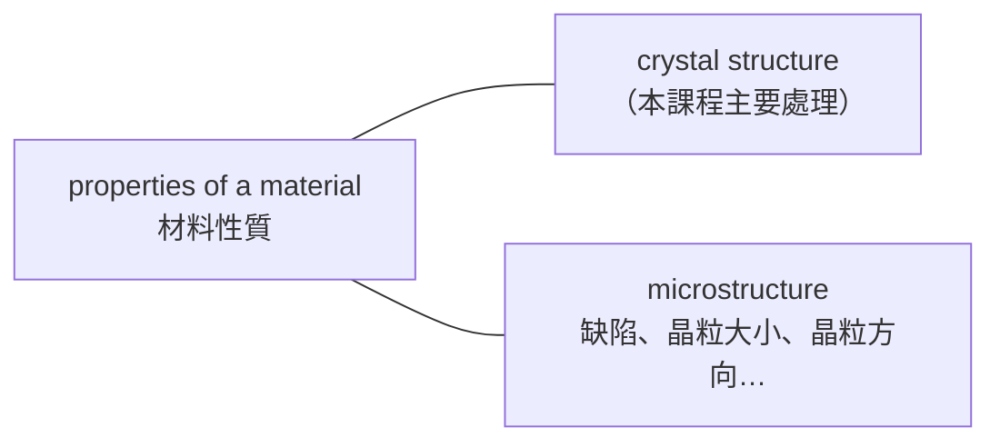

# crystal structure and microstructure

## Definition
- 材料的性質由兩部分決定：crystal structure（晶體結構），加上 microstructure（顯微組織）。
- microstructure 包括缺陷的種類與數量、grain size（晶粒大小）、grain orientation（晶粒方向）等。
- 這門課**主要**處理 crystal structure 這一部分（[[來源-AW01C]] slide 24）。

## Mathematical form
無

## Physical meaning
- 晶體結構決定固體的性質，「但還有更多」（[[來源-AW01C]] slide 23）。這裡的「更多」就是 microstructure：同一種晶體結構，晶粒與缺陷不同，材料性質也會不同（[[來源-AW01C]] slide 24）。
- 這也是課程要區分 solid 與 material 的原因（[[來源-AW01C]] slide 22）。

## Figure

自繪，依據 [[來源-AW01C]] slide 24。

## Validity and common misconceptions
- ab initio 計算通常處理的是完美晶體（加上少量缺陷），所以算出來的是「solid 的性質」。和實際「material 的性質」比較時，要考慮 microstructure 的影響。這是根據 slide 24 的分工推論，講義沒有逐字這樣說。

## Related equations
- 無

## Related concepts
- 上層：[[solid]]
- 相關：[[total energy]]
- 材料科學的角度見 mse-wiki 的晶體結構相關頁面。

## Conflicts and differences

## Supplementary notes (not from source)

## Sources
- 原站：https://www.compmatphys.org/topics/solids-as-quantum-systems/
