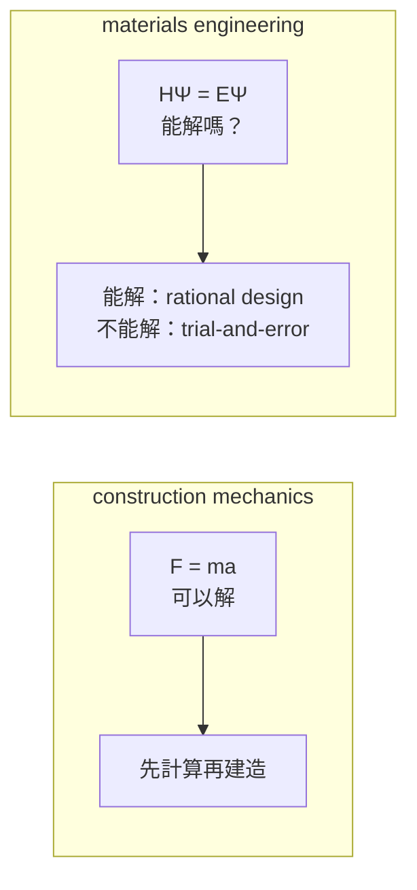

# materials design from thought

## Definition
不做實驗、只靠計算來設計新材料的願景。Gerbrand Ceder 描繪的這個願景，有時被稱為 "the design of new materials from thought"（[[來源-AW01F-creation]] 主題頁）。

## Mathematical form
無

## Physical meaning
- 課程認為，量子層級的計算正在讓材料科學經歷一場（r）evolution；同樣的訊息也出現在經濟與政治場合，例如 World Economic Forum（[[來源-AW01F-creation]] 主題頁）。
- 和營建工程的類比（[[來源-AW01E]] slide 9）：
  - construction mechanics（營建力學）的基本方程式 $F=ma$ 可以解，所以蓋橋前不需要試蓋很多座；
  - materials engineering（材料工程）的基本方程式是 $\hat H\Psi=E\Psi$，能不能解才是問題。
- 對固體與材料做 ab initio simulation，是 trial-and-error（嘗試錯誤）與 rational design（理性設計）之間的差別（[[來源-AW01E]] slide 10）。

## Figure

自繪，依據 [[來源-AW01E]] slides 9–10。

## Validity and common misconceptions
- 這是願景，不是現況：主題頁請學員自己評估這個願景有多實際、離實現還有多遠（[[來源-AW01F-creation]] 主題頁）。
- 「不做實驗」是指設計階段的篩選與預測；講義沒有主張完全不需要實驗驗證。

## Related equations
- 無

## Related concepts
- 上層：[[ab initio]]
- 相關：[[maturity of physics fields]]、[[theory versus simulation]]
- 邏輯鏈：[[quantum mechanics plus computing power enables materials simulation]]

## Conflicts and differences

## Supplementary notes (not from source)

## Sources
- 原站：https://www.compmatphys.org/topics/the-creation-of-materials-from-thought/
- 原站：https://www.compmatphys.org/topics/advantages/
