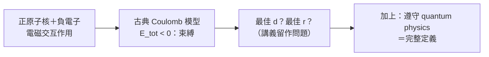

# solid

## Definition
課程對 solid（固體）的定義：由帶正電的原子核和帶負電的電子組成，粒子之間全都以電磁作用交互作用，而且遵守 quantum physics 規定的運動方程式的系統（[[來源-AW01C]] slides 13、21）。

## Mathematical form
無（定義本身不含式子；用古典 Coulomb 作用估算的玩具模型見 [[total energy]]）

## Physical meaning
- 定義分兩步給出：
  - 第一步只說「正原子核＋負電子＋電磁作用」（[[來源-AW01C]] slide 13）；
  - 第二步才加上「遵守 quantum physics」（[[來源-AW01C]] slide 21）。
- 兩步之間的論證：用古典 Coulomb 作用算一個二維玩具晶體的能量。能量為負，所以晶體是束縛的；接著講義追問最佳晶格參數 $d$ 是多少，再拿更簡單的古典 H 原子問最佳鍵長 $r$（[[來源-AW01C]] slides 15–20）。
- 主題頁的結論是：固體真的是量子系統，沒有其他辦法（[[來源-AW01C]] 主題頁）。
- 多體效應：只有一對電荷時只有 e-n interaction；兩對以上就同時有 e-n、n-n、e-e interaction，是「性質不同的系統」（$1+1\neq2$）（[[來源-AW01C]] slide 11）。
- 要區分 solid（固體）與 material（材料）（[[來源-AW01C]] slide 22）：材料的性質還取決於 microstructure，見 [[crystal structure and microstructure]]。

## Figure

自繪，依據 [[來源-AW01C]] slides 13–21。

## Validity and common misconceptions
- 誤解：「固體就是原子排成晶格」。課程的定義用的是原子核和電子，而不是原子；原子本身也是這些粒子交互作用的結果。
- 這個定義描述的是 solid；material 還包含 microstructure 等因素（[[來源-AW01C]] slides 22、24）。

## Related equations
- 無

## Related concepts
- 上層：[[ab initio]]
- 相關：[[total energy]]、[[crystal structure and microstructure]]
- 邏輯鏈：[[quantum mechanics plus computing power enables materials simulation]]

## Conflicts and differences

## Supplementary notes (not from source)
- ⚠️待查證：為什麼古典模型不夠：純 Coulomb 吸引的能量 $\propto -1/d$，$d$ 越小能量越低，所以古典模型找不到有限的最佳 $d$（古典 H 原子的 $r$ 也一樣會縮到 0）。這是一般物理知識的推論，講義只留下問題，答案在影片中。

## Sources
- 原站：https://www.compmatphys.org/topics/solids-as-quantum-systems/
