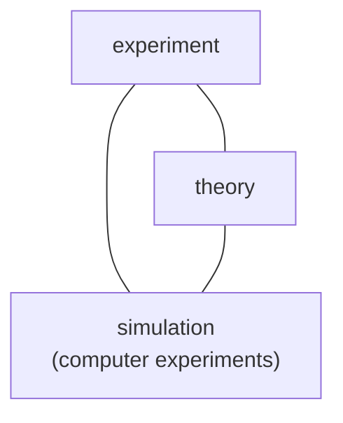

# theory versus simulation

## Definition
科學有三個支柱：experiment（實驗）、theory（理論）、simulation（模擬）。其中 simulation 又稱 computer experiments（電腦實驗）（[[來源-AW01F]] slide 3）。theory 和 simulation 是兩種不同的活動，要能說出區分兩者的標準（[[來源-AW01F]] 主題頁）。

## Mathematical form
無

## Physical meaning
- 課程的主張：以量子為基礎的材料計算是 simulation activity，不是 theoretical activity（[[來源-AW01F]] 主題頁）。
- 講義的投影片依序把 experiment 和 theory 圈在一起、把 experiment 和 simulation 圈在一起，最後單獨圈出 simulation（[[來源-AW01F]] slides 4–6）。完整的論證在影片（2014 年 PSI 演講片段）中（[[來源-AW01F]] slide 2）。

## Figure

自繪，依據 [[來源-AW01F]] slide 3。

## Validity and common misconceptions
- 常見的直覺是「用電腦算方程式＝做理論」。主題頁請學員說明為什麼很多人有這種直覺，以及為什麼它不對（[[來源-AW01F]] 主題頁）。

## Related equations
- 無

## Related concepts
- 上層：[[ab initio]]
- 相關：[[materials design from thought]]、[[parallelization]]
- 邏輯鏈：[[quantum mechanics plus computing power enables materials simulation]]

## Conflicts and differences

## Supplementary notes (not from source)
- ⚠️待查證：一種常見的區分方式：theory 是發展新的概念或近似，得到可以一般化的結論；simulation 是把已知的方程式套在特定系統上算出結果，角色像在電腦裡做實驗。這是一般說法，不是講義內容，課程的標準要以影片為準。

## Sources
- 原站：https://www.compmatphys.org/topics/theory-versus-computation/
