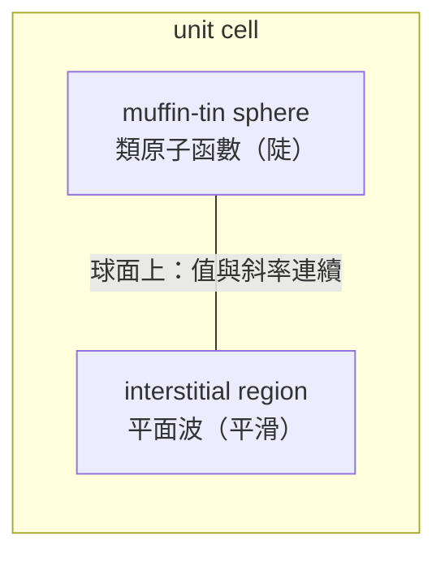

# augmented plane wave methods

## Definition
augmented plane wave methods（擴增平面波法）：把空間分成兩區（volume partitioning），各用適合的基底函數（[[來源-basis-sets-2]] slides 6–8）：
- 原子核附近：用類原子的函數；如果取成球，叫 muffin-tin spheres；
- 原子之間：用平面波。

包括 APW、LAPW、APW+lo、LMTO（[[來源-basis-sets-2]] slide 8）。

## Mathematical form
講義的式子以圖為主，此處只記下結構（[[來源-basis-sets-2]] slides 10–24）：
- **APW**：球外是平面波，球內是原子型徑向函數乘上球諧函數，在球面上接起來。但球內函數依賴能量，帶來額外的迴圈。
- **LAPW**：把球內的徑向函數在猜測的能量 $E_0$ 附近做一階 Taylor 展開（linearization），得到不依賴能量的基底；兩組係數由球面上的值與斜率連續決定。

## Physical meaning
- 動機：平面波基底之所以大，是因為核附近的陡峭特徵。兩種解法（[[來源-basis-sets-2]] slide 4）：
  - 用 pseudopotential 去掉陡峭特徵；
  - 改用本身帶有陡峭特徵的基底（本頁）。
- 核附近的電子幾乎像自由原子；遠離原子核時密度平滑、接近自由電子（[[來源-basis-sets-2]] slide 6）。
- LAPW 的細節（[[來源-basis-sets-2]] slides 25–27）：
  - $E_0$ 要接近本徵值，所以對不同原子、不同 $\ell$ 用不同值；需要時加 local orbitals（LO）；
  - 之後的流程和 PW+PP 相同：選精度參數、算 $H$ 與 $S$、對角化。
- APW+lo：保留 LAPW 的準確度，但基底較小，約快 10 倍（[[來源-basis-sets-2]] slide 29）。
- LMTO：想法類似，但球內接到 Hankel functions；對緊密堆積的固體可以很快（[[來源-basis-sets-2]] slide 31）。
- 程式：LAPW 代表是 WIEN2k（[[來源-basis-sets-2]] slide 52）。

## Figure

自繪，依據 [[來源-basis-sets-2]] slides 6–7、24。

## Validity and common misconceptions
- LAPW 是準確度的「golden standard」；APW+lo 與 PAW 對元素晶體的預測非常接近，例如 VASP 對 WIEN2k 的 $\Delta=1.8$ meV/atom（[[來源-basis-sets-2]] slides 30、60、67）。

## Related equations
- [[generalized eigenvalue problem HC=SCE]]

## Related concepts
- 上層：[[all-electron method]]
- 相關：[[plane-wave basis set]]、[[projector augmented wave method]]、[[basis set]]

## Conflicts and differences

## Supplementary notes (not from source)
- 講義最後推薦 S. Cottenier 的《Density Functional Theory and the family of (L)APW-methods: a step-by-step introduction》作為延伸閱讀（[[來源-basis-sets-2]] slide 54）。

## Sources
- 原站：https://www.compmatphys.org/topics/optional-basis-sets-in-more-depth/
