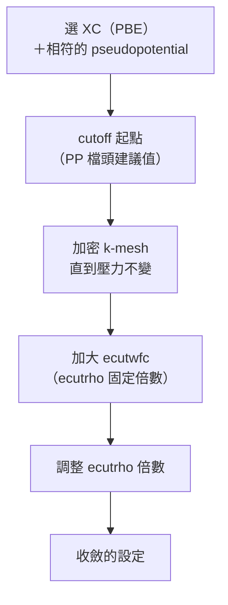

# convergence testing

## Definition
convergence testing（收斂測試）：對每一種新晶體，逐步加密 k-mesh、加大 basis set，直到被監看的物理量不再改變。這樣才能確定算出來的是數值上正確的結果，而不是雜訊（[[來源-lets-play-w3b]] slide 1）。

## Mathematical form
無（流程見下）

## Physical meaning
- 步驟（[[來源-lets-play-w3b]] slides 3–6）：
  1. 選 XC-functional：課程用 PBE，pseudopotential 也要是 PBE；
  2. 用 pseudopotential 檔頭建議的 cutoff 當起點；
  3. 固定 cutoff，逐步加密 k-mesh；
  4. 固定 k-mesh，逐步加大 `ecutwfc`，此時 `ecutrho` 保持固定倍數；
  5. 最後再測 `ecutrho` 與 `ecutwfc` 的倍數。
- 監看的量：hydrostatic pressure 對數值精度很敏感；它收斂了，比較不敏感的性質也會收斂（[[來源-lets-play-w3b]] slide 4）。
- 精度與速度永遠要取捨：
  - 太粗的設定很快，但結果可能離譜，只算一次看不出來；
  - 太密的設定要多花好幾倍時間，卻得到同樣結果（[[來源-lets-play-w3b]] slides 4、6）。
- 文件的說法：每次計算新類型的系統都「MUST」做，否則不是在算雜訊，就是多花 10 倍的計算時間（[[來源-lets-play-w3b]] slide 6）。
- 平面波基底的優點之一，就是收斂性容易測試（[[來源-basis-sets-1]] slide 59）。

## Figure

自繪，依據 [[來源-lets-play-w3b]] slides 3–6。

## Validity and common misconceptions
- 收斂測試只處理**數值**誤差（basis、k-mesh），處理不了 XC 近似造成的誤差。換了 XC 也不保證更接近實驗（[[來源-lets-play-w3a]] slide 1：XC 是唯一的本質近似）。

## Related equations
- 無

## Related concepts
- 相關：[[k-point sampling]]、[[cutoff energy]]、[[basis set]]
- 實作：[[實作-w3 convergence testing]]
- 邏輯鏈：[[convergence testing fixes the numerical parameters]]

## Conflicts and differences

## Supplementary notes (not from source)
- 文件附錄提到 JARVIS-ML 可以粗估起始參數，但它在 halite 例子中建議的 k-mesh 明顯不足，只能當提示（[[來源-lets-play-w3b]] slides 6–7）。

## Sources
- 原站：https://www.compmatphys.org/topics/density-functional-theory-2-convergence-testing/
