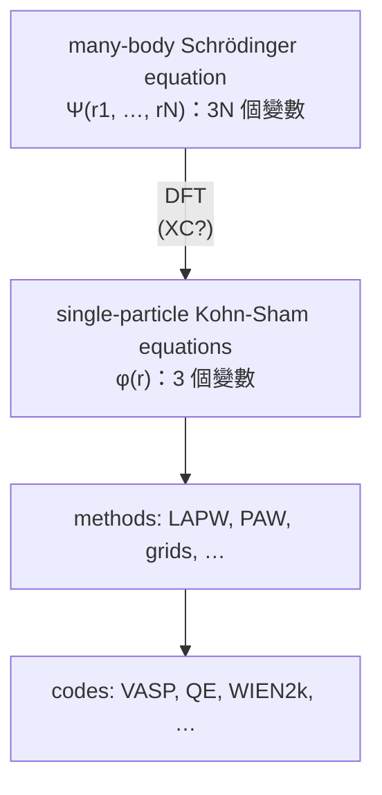

# density functional theory

## Definition
density functional theory（DFT，密度泛函理論）把難解的 many-body Schrödinger equation，轉換成一組 single-particle Kohn-Sham equations，並以 electron density 作為核心變數（[[來源-AW02A]] slide 4）。

## Mathematical form
$$
\hat H\,\Psi(\vec r_1,\dots,\vec r_N)=E\,\Psi(\vec r_1,\dots,\vec r_N)
\;\xrightarrow{\ \text{DFT}\ }\;
\hat H_{KS}\,\phi(\vec r)=E\,\phi(\vec r)
$$
符號說明：左邊是 N 個電子的多體波函數 $\Psi$，有 $3N$ 個空間變數；右邊是單粒子軌域 $\phi$，只有 3 個空間變數（[[來源-AW02A]] slide 4）。各項與單位見 [[Kohn-Sham equations]]。

## Physical meaning
- 在 [[three levels of approximation]] 中，DFT 和 Hartree-Fock 並列 level 2，建立在 Born-Oppenheimer（level 1）之上，之後還需要 solution techniques（level 3）（[[來源-AW02D]] slide 2）。
- teaser 的比喻（「Delusion Factory」）：一群顧問用簡單的電路模型，就能重現大型實驗設施的量測結果。DFT 也是用一個簡單的替代系統，重現真實系統的結果（[[來源-AW02A]] slides 3–4）。
- 行星類比（[[來源-AW03H-teaser]] slides 16–17）：
  - 把行星之間的交互作用關掉，改加一個精心選擇的外加場，就能重現每顆行星的精確運動；
  - 對電子來說，就是換成不交互作用的 quasi-electrons，再加上一個由 universal XC functional 推導出來的 exchange-correlation field。
- 關鍵在 exchange-correlation：teaser 的最後一張投影片把它標成「XC?」（[[來源-AW02A]] slide 5）。實作文件也說，DFT 中唯一的本質近似是 XC-functional 的選擇（[[來源-lets-play-w3a]] slide 1）。
- 理論基礎是 [[first Hohenberg-Kohn theorem]] 與 [[second Hohenberg-Kohn theorem]]；實際作法是 [[Kohn-Sham scheme]]。
- 實作上用 LAPW、PAW、grids 等方法求解，對應程式有 VASP、Quantum ESPRESSO、WIEN2k 等（[[來源-AW02A]] slide 4）。

## Figure

自繪，依據 [[來源-AW02A]] slides 4–5。

## Validity and common misconceptions
- 誤解：「DFT 本身是近似理論」。HK 定理與 KS 方程式在形式上是精確的；近似來自 XC-functional 的選擇（[[來源-lets-play-w3a]] slide 1）。另外 Born-Oppenheimer 與數值方法也會帶來近似（[[來源-AW02D]] slide 2）。
- HK 定理講的是**基態**性質（見 [[first Hohenberg-Kohn theorem]]）。

## Related equations
- [[Kohn-Sham equations]]
- [[Hamiltonian of a solid]]

## Related concepts
- 上層：[[ab initio]]
- 相關：[[Hartree-Fock method]]、[[HF versus DFT]]、[[exchange-correlation functional]]
- 邏輯鏈：[[HK theorems justify the Kohn-Sham scheme]]

## Conflicts and differences

## Supplementary notes (not from source)
- Hohenberg 與 Kohn（1964）、Kohn 與 Sham（1965）的論文奠定了 DFT；Walter Kohn 因此獲得 1998 年諾貝爾化學獎。這是一般知識。

## Sources
- 原站：https://www.compmatphys.org/topics/a-dft-teaser/
