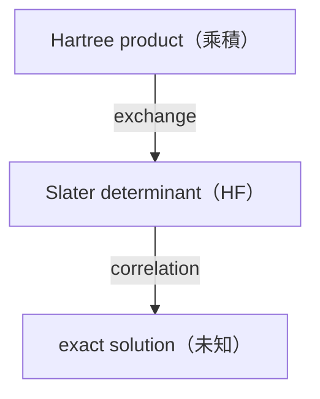

# exchange and correlation

## Definition
- 古典的 correlation：獨立粒子解與精確解的能量差（[[來源-AW03E]] slide 5）。
- 量子的 exchange：多體波函數寫成乘積（Hartree product）與寫成 Slater determinant 的能量差（[[來源-AW03E]] slide 4）。
- 量子的 correlation：Hartree-Fock 解與精確解的能量差（[[來源-AW03E]] slide 5）。

## Mathematical form
$$
E^{H}_0\;\xrightarrow{\ \text{exchange}\ }\;E^{HF}_0\;\xrightarrow{\ \text{correlation}\ }\;E^{\text{exact}}_0
$$
三個能量由高到低。這是依 [[來源-AW03E]] slide 4 的能階圖寫成的式子。

## Physical meaning
- 古典例子（[[來源-AW03E]] slides 2–3）：
  - 太陽–地球的二體問題有解析解；加上木星就只能數值解；
  - 「太陽–地球」與「太陽–木星」各自的總能量之和，與三體系統總能量的差，就是古典的 correlation energy。
- 量子系統需要不同的定義，因為「獨立電子」的波函數本身就有兩種寫法（乘積或 Slater determinant），中間還隔著 exchange（[[來源-AW03E]] slides 4–5）。
- correlation 是精確解難以求得的主要原因（[[來源-AW03E]] 主題頁）。
- HF 依定義有精確的 exchange、沒有 correlation；精確的 DFT 兩者都有（[[來源-AW03F]] slide 3）。

## Figure

自繪，依據 [[來源-AW03E]] slide 4（能量由上往下降低）。

## Validity and common misconceptions
- 主題頁的問題：為什麼古典與量子系統的 correlation 要用不同的定義（[[來源-AW03E]] 主題頁）？關鍵在量子的「獨立粒子」基準有乘積與 Slater determinant 兩種。這是依 slides 4–5 的整理。

## Related equations
- 無

## Related concepts
- 相關：[[exchange-correlation functional]]、[[Hartree-Fock method]]、[[post-Hartree-Fock methods]]、[[Slater determinant]]

## Conflicts and differences

## Supplementary notes (not from source)
- 主題頁推薦 University of Edinburgh 談 indistinguishable particles 與 exchange 的講義作為選讀。

## Sources
- 原站：https://www.compmatphys.org/topics/correlation/
