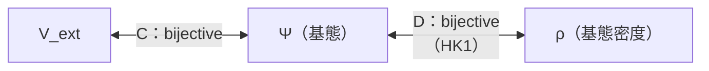

# first Hohenberg-Kohn theorem

## Definition
多電子系統的基態密度和 external potential 之間存在一對一（one-to-one）的對應（[[來源-AW03A]] slide 9）。Hohenberg 與 Kohn，1964（[[來源-AW03A]] slide 5）。

## Mathematical form
定義兩個映射（[[來源-AW03A]] slides 2–5）：
$$
C:\hat V_{ext}\mapsto\Psi,\qquad D:\Psi\mapsto\rho
$$
- 依建構方式，兩者都是 surjective（滿射）；
- $C$ 是 injective（不意外）；
- $D$ 也是 injective（非常意外），這就是第一定理；
- 所以兩者都是 bijective（雙射）（[[來源-AW03A]] slide 8）。

推論：任何可觀測的基態性質都能寫成密度的**唯一**泛函（[[來源-AW03A]] slide 9）：
$$
\text{property}=\langle\Psi|\hat O|\Psi\rangle=O[\rho]
$$

## Physical meaning
- 波函數 $\Psi(\vec r_1,\dots,\vec r_N)$ 有 $3N$ 個變數，密度 $\rho(\vec r)$ 只有 3 個；但定理保證，基態密度含有的資訊和基態波函數一樣多（[[來源-AW03H-teaser]] slide 23）。
- 集合的定義很重要：$\Psi$ 只包含「某個 external potential 的基態」，$\rho$ 只包含由這些基態得到的密度，不是所有波函數或所有密度（[[來源-AW03A]] slide 3）。

## Figure

自繪，依據 [[來源-AW03A]] slides 8–9。

## Validity and common misconceptions
- 證明針對 non-degenerate ground states（[[來源-AW03A]] slide 7）。
- 定理只說這個泛函**存在而且唯一**，沒有給出它的形式；實際的形式要靠 Kohn-Sham 與 XC 近似（見 [[exchange-correlation functional]]）。
- 只適用於**基態**性質。

## Related equations
- 無（證明見 [[推導-first Hohenberg-Kohn theorem]]）

## Related concepts
- 上層：[[density functional theory]]
- 相關：[[second Hohenberg-Kohn theorem]]、[[external potential]]、[[electron density]]
- 邏輯鏈：[[HK theorems justify the Kohn-Sham scheme]]

## Conflicts and differences

## Supplementary notes (not from source)
- 簡併基態的推廣（Levy constrained search 等）是一般知識，講義沒有談。

## Sources
- 原站：https://www.compmatphys.org/topics/first-hohenberg-kohn-theorem/
