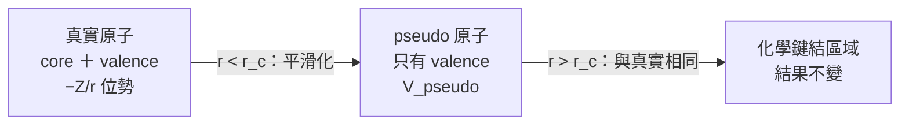

# pseudopotential

## Definition
pseudopotential methods（贗勢方法）：改解一個「假想的晶體」，它只在有興趣的區域（離原子核遠的地方）和真實晶體一樣；在原子核附近，用平滑的 pseudo 波函數與 pseudo 位勢取代真實的（[[來源-AW03G-tris]] slides 10–11）。

## Mathematical form
示意（[[來源-AW03G-tris]] slide 10）：
- 在截斷半徑 $r_c$ 之內：
  - 真實的價電子波函數 $\Psi_{\sim Z/r}$ 劇烈振盪，換成平滑、沒有節點的 $\Psi_{pseudo}$；
  - 真實的 $-Z/r$ 位勢換成較淺的 $V_{pseudo}$。
- 在 $r_c$ 之外：pseudo 與真實的波函數、位勢都相同。

## Physical meaning
- core 與 valence electrons 的差別（[[來源-basis-sets-1]] slide 55）：
  - core electrons：束縛很深、局域在原子核附近，換了化學環境也幾乎不變；
  - valence 波函數：為了和 core 正交，在核附近劇烈振盪，而且會隨化學環境大幅改變。
- 優點（[[來源-basis-sets-1]] slide 57）：
  - 要處理的電子變少；
  - 價電子波函數在核附近不再劇烈振盪，所需基底函數大幅減少。
- 常搭配 plane waves；PAW 與部分 local orbital 方法也屬於這一類（[[來源-AW03G-tris]] slide 12）。
- 缺點：可能造成不物理的假象，而且未必出現在預期的性質上（[[來源-basis-sets-1]] slide 59），所以 pseudopotential 需要驗證（[[來源-basis-sets-1]] slide 61）。
- 實作（Quantum ESPRESSO）：
  - pseudopotential 是 UPF 檔，寫在 `ATOMIC_SPECIES`（[[來源-lets-play-w2]] slide 3）；
  - 課程建議使用 SSSP 函式庫（[[來源-lets-play-w2]] slides 5–6）；
  - pseudopotential 是針對特定 XC-functional 做的，不可混用（[[來源-lets-play-w3a]] slide 1）。

## Figure

自繪，依據 [[來源-AW03G-tris]] slides 10–11。

## Validity and common misconceptions
- PW+PP 很受歡迎：大家都在用、benchmark 多、數學簡單，新理論通常先在 PP 程式裡實作（[[來源-basis-sets-2]] slide 30）。
- 不能直接得到原子核附近的物理量（core level、hyperfine），這類問題要用 [[all-electron method]]（[[來源-basis-sets-2]] slide 30）。

## Related equations
- 無

## Related concepts
- 上層：[[basis set]]
- 對照：[[all-electron method]]
- 相關：[[plane-wave basis set]]、[[projector augmented wave method]]、[[cutoff energy]]、[[generalized gradient approximation]]

## Conflicts and differences

## Supplementary notes (not from source)
- 常見的種類：norm-conserving、ultrasoft、PAW。QE 的檔名常標示 XC 與種類，例如 `pbe-n-kjpaw` 表示 PBE、PAW。這是一般知識。

## Sources
- 原站：https://www.compmatphys.org/topics/numerical-solution-methods/
