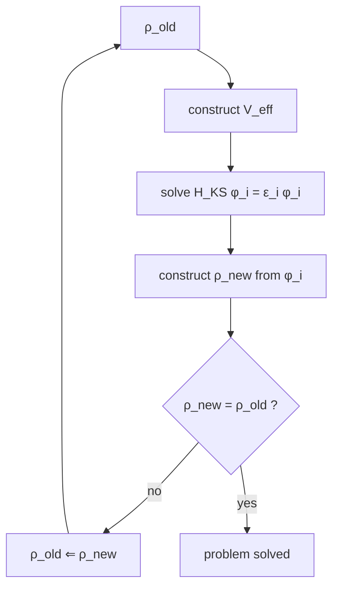

# self-consistent field

## Definition
self-consistent field（SCF，自洽場）問題：要解 $\hat H_{KS}$ 才能得到 $\phi_i$ 與 $\rho$，但要先知道 $\rho$ 才寫得出 $\hat H_{KS}$。所以必須迭代求解（scf-scheme）（[[來源-AW03G]] slide 7）。

## Mathematical form
迭代流程（[[來源-AW03G]] slide 8）：
1. 從 $\rho_{old}$ 建出 $V_{eff}$；
2. 解 $\hat H_{KS}\phi_i=\epsilon_i\phi_i$ 得到 $\phi_i$；
3. 由 $\phi_i$ 建出 $\rho_{new}$；
4. 若 $\rho_{new}=\rho_{old}$，問題解決；否則令 $\rho_{old}\Leftarrow\rho_{new}$，回到 1。

## Physical meaning
- 收斂後的密度和它產生的位勢互相一致，所以叫「自洽」。
- 實作：Quantum ESPRESSO 的 `calculation='scf'` 就是做這個迴圈。輸入檔 `&ELECTRONS` 裡的 `conv_thr`（收斂門檻）與 `mixing_beta`（密度混合比例）控制迭代（[[來源-lets-play-w2]] slides 2、5）。

## Figure

自繪，依據 [[來源-AW03G]] slide 8。

## Validity and common misconceptions
- 實際上不會直接用 $\rho_{new}$ 取代 $\rho_{old}$，而是兩者混合（mixing），以免振盪不收斂；「相等」也是指差異小於門檻。這是一般知識，對應 QE 的 `mixing_beta`、`conv_thr`。

## Related equations
- [[Kohn-Sham equations]]
- [[generalized eigenvalue problem HC=SCE]]

## Related concepts
- 上層：[[Kohn-Sham scheme]]
- 相關：[[basis set]]、[[Hartree potential]]
- 實作：[[實作-w2 a basic calculation]]

## Conflicts and differences

## Supplementary notes (not from source)
- 用 basis set 時，第 2 步就是解一次 $HC=SCE$；在 LAPW 方法中，還有更多層迴圈（見 [[augmented plane wave methods]]）。

## Sources
- 原站：https://www.compmatphys.org/topics/numerical-solution-methods/
