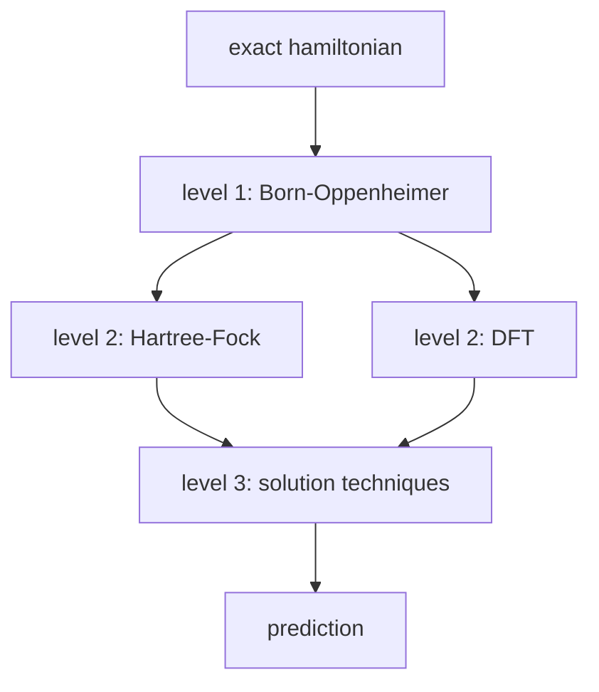

# three levels of approximation

## Definition
課程用來定位各主題的架構圖：從精確的 Hamiltonian 出發，經過三層近似，最後得到預測（[[來源-AW02D]] slide 2）：

| 層級 | 內容 |
|---|---|
| 出發點 | exact hamiltonian |
| level 1 | Born-Oppenheimer |
| level 2 | Hartree-Fock **或** DFT |
| level 3 | solution techniques |
| 終點 | prediction |

## Mathematical form
無

## Physical meaning
- 這張圖在 AW02D、AW02E、AW02F、AW02G、AW03F、AW03G 的開頭都重複出現，用來標示該主題處於哪一層（例如 [[來源-AW02D]] slide 2）。
- level 1 對應 [[Born-Oppenheimer approximation]]。
- level 2 的兩條路：[[Hartree-Fock method]]（及 [[post-Hartree-Fock methods]]）與 [[density functional theory]]。
- level 3 對應 [[basis set]] 與 [[self-consistent field]] 等數值求解方法。

## Figure

自繪，依據 [[來源-AW02D]] slide 2。

## Validity and common misconceptions
- 每一層都會帶進誤差。比較計算與實驗的差距時，要分清楚是哪一層造成的。這是依架構圖的推論，不是講義原文。

## Related equations
- [[Hamiltonian of a solid]]

## Related concepts
- 相關：[[Born-Oppenheimer approximation]]、[[density functional theory]]、[[Hartree-Fock method]]、[[basis set]]
- 邏輯鏈：[[HK theorems justify the Kohn-Sham scheme]]

## Conflicts and differences

## Supplementary notes (not from source)

## Sources
- 原站：https://www.compmatphys.org/topics/the-born-oppenheimer-approximation/
