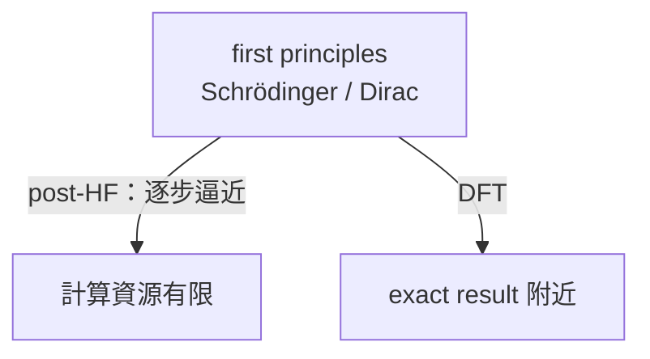

# HF versus DFT

Hartree-Fock／post-HF 與 DFT 想解的是同一個問題（[[來源-AW03F]] 主題頁）。

## Comparison
| | Hartree-Fock（＋post-HF） | DFT（精確 $E_{xc}$） | DFT（LDA 等近似） |
|---|---|---|---|
| exchange | 依定義精確 | 精確 | 部分 |
| correlation | 依定義沒有；由 post-HF 一步步加入 | 精確 | 部分 |
| 結果 | 可系統地逼近精確，但計算很耗時 | 精確 | 近似；改進「需要黑魔法」 |

（[[來源-AW03F]] slides 3–5）

## Picture
- 目標是從 first principles（Schrödinger 或 Dirac equation）直接解出精確結果（[[來源-AW03F]] slides 7–9）。
- post-HF 走一條逐步逼近的路，但總會撞上「計算資源永遠有限」這道牆；DFT 繞另一條路，可以打到靶心附近（[[來源-AW03F]] slides 10–12）。

自繪，依據 [[來源-AW03F]] slides 10–12。

## When to use which
- post-HF：小系統、高準確度（[[來源-AW03F]] slide 13）。
- DFT：大系統，但有一些無法控制的「noise」（[[來源-AW03F]] slide 13）。
- 選讀：Cohen et al.（2012）（[[來源-AW03F]] slide 13）。

## Related pages
- [[Hartree-Fock method]]、[[post-Hartree-Fock methods]]、[[density functional theory]]、[[exchange-correlation functional]]、[[exchange and correlation]]
