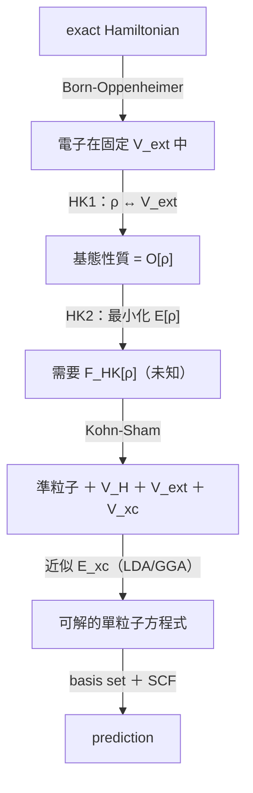

# HK theorems justify the Kohn-Sham scheme

## Question
為什麼可以不解 $3N$ 維的多體波函數，改解只有 3 個變數的密度與 Kohn-Sham 軌域？近似又在哪一步進來？

## Steps
1. [[Born-Oppenheimer approximation]]（approximation）：凍結原子核，只剩電子在固定的 external potential 中的問題；但方程式仍然太難解（[[來源-AW02D]] slides 4–5）。
2. [[first Hohenberg-Kohn theorem]]（theorem）：基態密度與 external potential 一對一，所以任何基態可觀測量都是密度的唯一泛函 $O[\rho]$（[[來源-AW03A]] slide 9）。
3. [[second Hohenberg-Kohn theorem]]（theorem）：總能量泛函 $E_{V_{ext}}[\rho]=F_{HK}[\rho]+\int\rho V_{ext}$ 在基態密度有最小值；把它最小化就能找到基態密度，但 $F_{HK}$ 未知（[[來源-AW03B]] slide 3）。
4. [[Kohn-Sham scheme]]（method）：用不交互作用的準粒子精確重現同一個密度。動能、Hartree、外位勢都能寫出來，未知的部分全部收進 $V_{xc}$（[[來源-AW03C]] slides 2–3）。
5. [[exchange-correlation functional]]（quantity）：精確的 XC 泛函存在但未知，只能近似（LDA、GGA）。這是唯一的本質近似（[[來源-AW03D]] slides 2–3）。
6. [[self-consistent field]]（method）：$\hat H_{KS}$ 依賴 $\rho$，所以要迭代到自洽；再用 [[basis set]] 把每一輪變成矩陣問題（[[來源-AW03G]] slides 6–8）。

## Figure

自繪，依據本頁 Steps 所引的投影片。

## Limitations
- 第 2、3 步只保證**基態**；激發態、能隙等需要另外處理（band gaps 單元）。
- 第 2 步的證明針對 non-degenerate ground states（[[來源-AW03A]] slide 7）。
- 第 5 步是近似：XC 泛函的誤差無法事先控制，改進「需要黑魔法」。
- 第 6 步的 basis set 截斷與 k-point 取樣是數值誤差，可以靠 [[convergence testing]] 控制。

## Related hands-on
- [[實作-w2 a basic calculation]]
- [[實作-w3 convergence testing]]

## Conflicts and differences

## Supplementary notes (not from source)
- 「第 4 步是精確的、第 5 步才引入近似」這個分層，是依講義的整理：AW03C slide 2 稱 KS 為「exact transformation」，實作文件說 XC 是唯一的本質近似。
- 這條鏈延伸了 U01 的 [[quantum mechanics plus computing power enables materials simulation]]：U01 說「方程式解不出來」，本鏈說明 DFT 怎麼讓它變得可解。

## Sources
- 原站：https://www.compmatphys.org/courses/compmatphys/ （U02 density functional theory）
