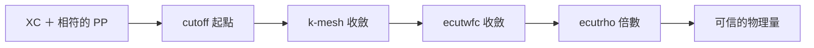

# convergence testing fixes the numerical parameters

## Question
DFT 計算要先決定哪些參數、照什麼順序決定，才能確定結果是物理而不是數值雜訊？

## Steps
1. [[exchange-correlation functional]]（quantity）：先選 XC（課程用 PBE），並確認 pseudopotential 是同一個 XC；這是唯一的本質近似，不屬於收斂測試的範圍（[[來源-lets-play-w3a]] slide 1；[[來源-lets-play-w3b]] slide 3）。
2. [[pseudopotential]]（method）：pseudopotential 檔頭建議的最小 cutoff 當作起點（[[來源-lets-play-w3b]] slide 3）。
3. [[k-point sampling]]（parameter）：固定 cutoff，逐步加密 k-mesh，監看 hydrostatic pressure 直到不變，再選精度與時間的折衷（[[來源-lets-play-w3b]] slide 4）。
4. [[cutoff energy]]（parameter）：固定 k-mesh，加大 `ecutwfc`（`ecutrho` 保持固定倍數），再測倍數（[[來源-lets-play-w3b]] slides 5–6）。
5. [[convergence testing]]（method）：得到的設定只適用於這種晶體；換新系統就要重做（[[來源-lets-play-w3b]] slide 6）。

## Figure

自繪，依據 [[來源-lets-play-w3b]] slides 3–6。

## Limitations
- 收斂測試只控制數值誤差（basis、k-mesh），控制不了 XC 近似（[[來源-lets-play-w3a]] slide 1）。
- 第 3、4 步的順序會互相影響：k-mesh 是在起始 cutoff 下測的；嚴格來說，cutoff 改變後可以再確認一次 k-mesh。這是一般知識的提醒，文件沒有要求。
- 平面波基底的優點是收斂容易測試，只要加大 cutoff（[[來源-basis-sets-1]] slide 59）。

## Related hands-on
- [[實作-w3 convergence testing]]

## Conflicts and differences

## Supplementary notes (not from source)

## Sources
- 原站：https://www.compmatphys.org/topics/density-functional-theory-2-convergence-testing/
