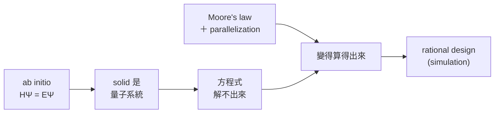

# quantum mechanics plus computing power enables materials simulation

## Question
既然描述固體的基本定律早就知道，為什麼直到現在才能用計算來研究、甚至設計材料？這也是 U01 整個單元的論證主線。

## Steps
1. [[ab initio]]（concept）：科學的目標是用一個無法再化約的數學模型重建自然現象；對材料來說，出發點是 $\hat H\Psi=E\Psi$（[[來源-AW01B]] slides 3–5）。
2. [[solid]]（concept）：固體是正原子核與負電子以電磁作用交互作用、並遵守 quantum physics 的系統，所以必須用量子力學描述（[[來源-AW01C]] slide 21）。
3. [[maturity of physics fields]]（concept）：公理已知，但方程式太複雜、解不出來；condensed matter physics 與 materials science 因此停在「需要運氣」的階段（[[來源-AW01D]] slides 3、5）。
4. [[Moore's law]]（concept）→ [[parallelization]]（concept）：計算能力持續指數成長；時脈停滯後，改靠平行化（[[來源-AW01G]] slides 5–7）。
5. [[materials design from thought]]（concept）：方程式變得可以算，materials engineering 就能像 construction mechanics 一樣，從 trial-and-error 走向 rational design（[[來源-AW01E]] slides 9–10）。
6. [[theory versus simulation]]（concept）：這樣的量子材料計算，性質上是 simulation（computer experiments），不是 theory（[[來源-AW01F]] slide 3）。

## Figure

自繪，依據 [[來源-AW01B]]、[[來源-AW01C]]、[[來源-AW01D]]、[[來源-AW01G]]、[[來源-AW01E]] 的投影片。

## Limitations
- 第 4 步到第 5 步之間，還需要「好的近似方法」才能讓方程式真的可解，也就是 U02 的 DFT。這一步延伸成另一條鏈：[[HK theorems justify the Kohn-Sham scheme]]。
- 計算的是 solid（理想晶體）的性質；material 的性質還取決於 microstructure（[[crystal structure and microstructure]]）。

## Related hands-on
- [[實作-w1 prepare your environment]]

## Conflicts and differences

## Supplementary notes (not from source)
- 把第 3 步（解不出來）和第 4 步（計算能力成長）串成「所以現在可以」，是本頁的整理；講義是在不同主題中分別提出這兩點。

## Sources
- 原站：https://www.compmatphys.org/courses/compmatphys/ （U01 setting the stage）
